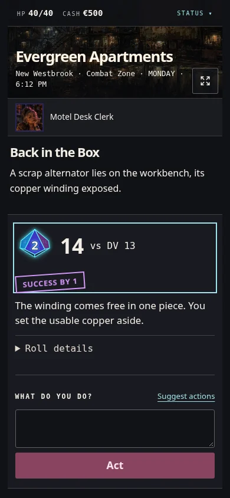
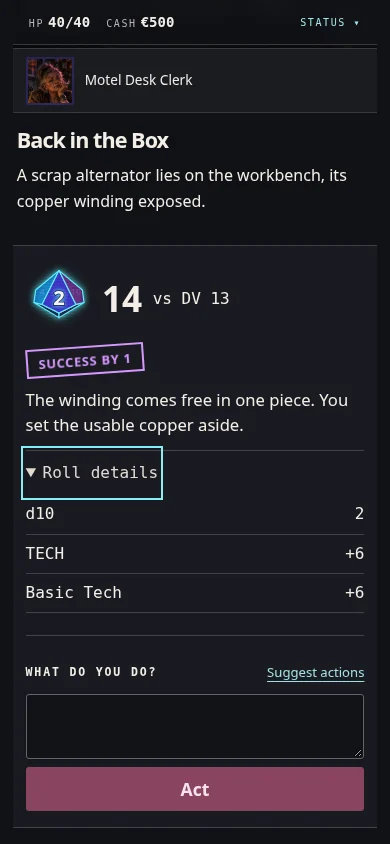

# Life skill-check review

Before, Life showed the modifier and target above a repeated stat grid. The die landed, the arithmetic counted up and the stamp followed. A campaign refetch could remove the check card as soon as it saw the logged roll, while the normal scene wait competed with the dice.

Now the skill, intent, effective modifier, target, and odds are together before the roll. Luck locks at activation. The cyan die lands with the total and verdict, and the passage appears underneath. The same card remains while the composer returns. **Roll details** holds the original modifiers, including critical dice and spent Luck.

## Matched captures

Each desktop pair uses the same Evergreen campaign, engine inputs, viewport and seeded copper-wire outcome. The landed pair holds the same narrator response until the screenshot is taken. The old completed capture shows where the roll used to disappear.

| Copper-wire check | Before · 1366 × 768                | After · 1366 × 768                |
| ----------------- | ---------------------------------- | --------------------------------- |
| Ready             | [Ready](before-ready.webp)         | [Ready](after-ready.webp)         |
| Landed            | [Landed](before-landed.webp)       | [Landed](after-landed.webp)       |
| Narrated          | [Completed](before-completed.webp) | [Completed](after-completed.webp) |

| 390 px · details collapsed                                                     | 390 px · details expanded                                                             |
| ------------------------------------------------------------------------------ | ------------------------------------------------------------------------------------- |
|  |  |

## Verified paths

- The same Life screen and check engine ran the seeded desktop and phone fixture with local campaign reads and scripted narration. It exercises both dice reveals, an opposed tie, ordinary success and failure, a success exactly at DV, natural 1 and 10, a one-point Luck spend and an empty pool.
- Keyboard activation, visible focus, result status and collapsed details were checked. The fixture checks that a repeated activation makes one request, a slow narrator leaves the landed result visible, and a fast narrator returns the composer alongside the outcome.
- The browser fixture exercises failure before a save, failure after a save, and a temporarily unreadable ledger. Recovery retries the same roll only when it is verified unsaved. A saved roll survives without replaying its settlement. When narration is unavailable, the player can continue with the recorded result.
- Local PostgreSQL replay verified the authenticated transaction, duplicate prompt handling, stale Luck, and owner isolation. Apply [the migration](../../supabase/migrations/20261118020000_life_check_record.sql) before serving the updated UI. The engine owns the roll, and the transaction records the roll and its Luck cost together.

The walkthrough used Chromium with desktop and phone viewports. Live signed-in play, a physical phone and screen-reader speech remain outside the checks.

## Reproduce

From the checkout, build with `bun run build`, then run:

```sh
node tools/life/capture.mjs /tmp/life-roll-after --roll
```

Set `CHROMIUM_PATH` if using a local Chromium executable. To reproduce the three baseline captures, build a separate checkout at `ecd01e4`, then run the same script by absolute path from that checkout. The fixture blocks external browser requests.
