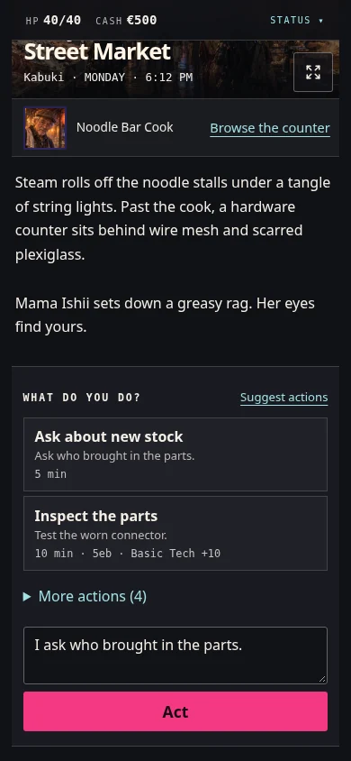
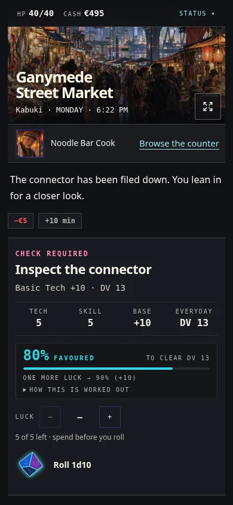

# Life play screen review

The location, the current passage and the next decision now share the main reading column. Ganymede uses the crowd and hanging lights from its catalog painting. Evergreen uses the walkway and apartment sign from its own painting. The market cook and the motel clerk come from the walk-ons recorded on their respective turns. Mama Ishii being named in the prose does not turn the cook's portrait into hers.

## Matched captures

Each pair uses the same browser dimensions, campaign, passage, art, draft and clock. Open either image to see it at its original size.

| Scene                  | Before                                           | After                                             |
| ---------------------- | ------------------------------------------------ | ------------------------------------------------- |
| Ganymede · 1366 × 768  | [Previous market](before-market-1366.webp)       | [Redesigned market](after-market-1366.webp)       |
| Evergreen · 1366 × 768 | [Previous apartment](before-apartment-1366.webp) | [Redesigned apartment](after-apartment-1366.webp) |
| Ganymede · 390 × 844   | [Previous market](before-market-390.webp)        | [Redesigned market](after-market-390.webp)        |
| Evergreen · 390 × 844  | [Previous apartment](before-apartment-390.webp)  | [Redesigned apartment](after-apartment-390.webp)  |

| Suggested actions · 390 × 844                                | Required check · 390 × 844                                                    |
| ------------------------------------------------------------ | ----------------------------------------------------------------------------- |
|  |  |

## What changed after comparing the references

- The broad market view gives the player a reason to pause. An always-expanded reference-sized painting would push a typical laptop decision below the fold. At 1366 × 768 the new hero is 192 px high and still expands on demand. In the matched market capture, the top of the Act button moved from 869 px to 579 px. The apartment moved from 823 px to 621 px.
- The magenta action and warm passage text survived the translation. Three bright bars would draw the eye to healthy, unchanged values every turn. The rail now keeps health and resources quiet and gives actual wounds and bills a label. Its character, contacts, journal and newspaper remain reachable from the phone status sheet.
- A phone test with six options made it too easy to lose the free-text field. The two leading suggestions now show all their quoted costs and skill information. The player can expand the others. A pending check takes this same position, with its intent, difficulty or opponent, Luck and the existing roll controls.

## Browser walkthrough

Chromium ran the game components, React Query turn lifecycle, catalog selectors and die with local campaign reads and deterministic responses. The interaction run used the existing shop review controller for the counter, local writes for movement and settlement, and the campaign screen selector for Job entry.

| Interaction                  | Observed result                                                                                                                                                                                                                                                              |
| ---------------------------- | ---------------------------------------------------------------------------------------------------------------------------------------------------------------------------------------------------------------------------------------------------------------------------- |
| Free text, failure and retry | The submitted text stayed visible during the wait. Failure left it in the field. Shift+Enter inserted a newline, an IME confirmation sent nothing, and two immediate submissions made one call.                                                                              |
| Options and a required roll  | Asking for options used the zero-minute path. Inspecting the parts passed the displayed ten minutes and five eurobucks. A DV 13 Basic Tech check replaced the field. Dedicating one Luck point passed one point with the engine roll and returned the player to their draft. |
| Vendor and status detours    | Both the market shortcut and a narrated browse event opened the counter. Back to scene recovered the draft. Character, Contacts, Journal and Screamsheet opened and closed by keyboard. A second campaign started with an empty field.                                       |
| Travel and authored play     | Journal travel closed the phone sheets and arrived at Nakamura’s Counter. Its delivery-ticket choice used the neighborhood handler. Accepting the catalog mission opened the separate Job screen with working map and status controls.                                       |
| Artwork and navigation       | The scene image and walk-on opened with a caption. The map and radio opened on a phone and returned keyboard focus. A failed painting left the place heading visible.                                                                                                        |
| Phone stress cases           | The long Petrochem & SovOil location name and an eighteen-passage fixture produced no horizontal overflow. At 390 × 480 the focused field and Act remained reachable. Motion was reduced in the interaction run.                                                             |

The smaller viewport and synthetic composition events exercise layout and input handling. A physical iOS or Android keyboard, hosted authentication, live audio playback and a live narrator session remain device and integration checks. The fixture made no paid model requests.

## Reproduce the captures

From the checkout to capture, install the locked dependencies, build the app, then run:

```sh
bun install --frozen-lockfile
bun run build
node tools/life/capture.mjs /tmp/life-after
```

The capture runner uses Playwright Chromium. Set `CHROMIUM_PATH` to a local Chromium executable if needed. To reproduce the baseline, build a separate checkout of `4e2f5b1` and run the same script by absolute path from that checkout. The script reads production styles and game source from its working directory. It serves the fixture on loopback, blocks external browser requests and writes PNGs only to the requested output directory. The images in this review are WebP copies.
